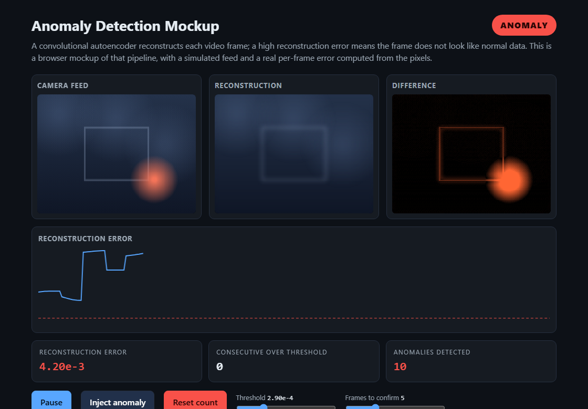

# Anomaly Detection Mockup

An interactive browser mockup of a video anomaly detector. A convolutional
autoencoder reconstructs each frame; when the reconstruction error is high, the
frame does not look like normal data and is flagged. This page recreates that
pipeline with a simulated feed and a real per-frame error computed from the
pixels, so it runs live in the browser with no model or camera.

> This is a simulated stand-in for professional work I can't share publicly. It
> mirrors the real detection logic (autoencoder reconstruction error against a
> threshold, confirmed over several frames), with a simulated feed in place of
> the live camera and trained model.

## How it works

- **Camera feed**: a simulated scene, with an occasional bright anomaly.
- **Reconstruction**: what an autoencoder trained on normal frames would output.
  It never contains the anomaly, because it was never trained on one.
- **Difference**: the per-pixel error between the two, brightened.
- **Reconstruction error**: the mean squared difference, plotted against a
  threshold. When it stays over the threshold for N frames in a row, an anomaly
  is logged. This is the same rule the original used (error over threshold,
  confirmed over several consecutive frames).

## Try it

Open `index.html` in a browser, or visit the live page. Use **Inject anomaly**
to force one, and the **threshold** and **frames to confirm** sliders to see how
sensitivity changes the detections.

## Tech

HTML · CSS · vanilla JavaScript · Canvas (real MSE computed from pixel data).
